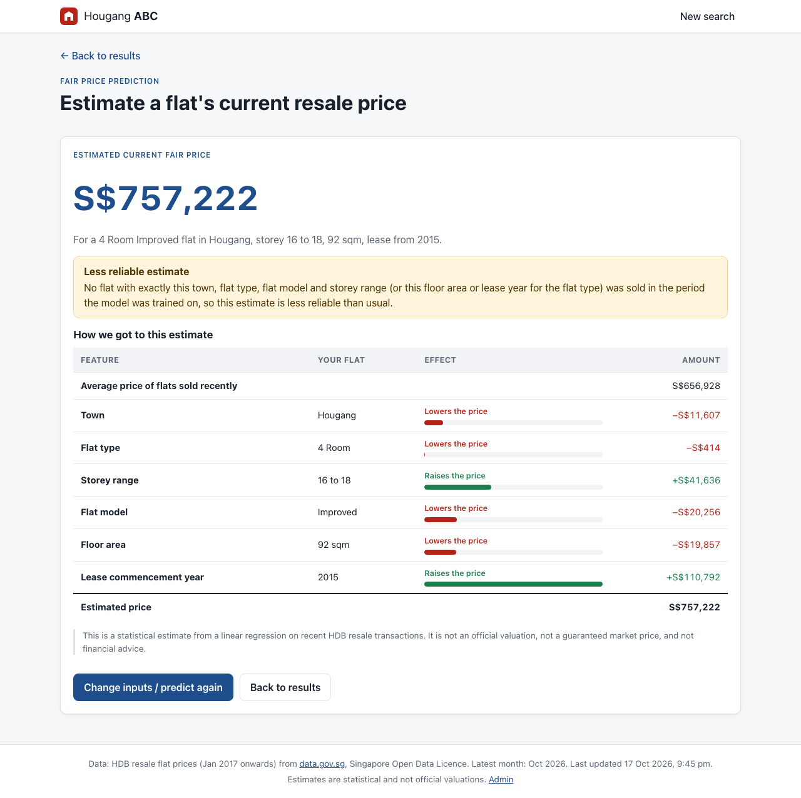

# Hougang ABC: Singapore HDB resale prices

SC2006 Software Engineering, Group 2. A web application for looking up Singapore HDB resale flat prices:

- **Search** by town, flat type, storey range, flat model and floor area, and browse the latest sales.
- **Explore** every matching transaction since 2017, with mean, median and a month-by-month price trend.
- **Estimate** a flat's current fair price with an ordinary least squares (OLS) linear regression, and see
  how each feature (town, flat type, storey, flat model, floor area, lease year) raises or lowers it.
- **Administer** (login required): upload datasets, see dataset status and model diagnostics. A daily job
  pulls new transactions from data.gov.sg.

React frontend → Flask JSON API → Python control classes → repository / OLS model / data.gov.sg client →
SQLite. Class, method and page names follow the team's design class diagram exactly (`docs/`).



## Requirements

- Python 3.11 or newer
- Node.js 18 or newer (tested with Node 24)
- Internet access to data.gov.sg for the first data load (the API works without a key)

## Install

```bash
# Backend
cd backend
python3.11 -m venv .venv
.venv/bin/pip install -r requirements-dev.txt

# Frontend
cd ../frontend
npm install
```

## Configure

Copy `.env.example` to `.env` in the repository root and set at least the admin password:

```bash
cp .env.example .env
# then edit .env:
ADMIN_USERNAME=admin
ADMIN_PASSWORD=choose-a-strong-password
```

The password is hashed when the server starts and the plaintext is discarded; it is never stored or
logged. Leave it empty to disable admin login. Every setting is documented in `.env.example`.

## Load the data (first time only)

```bash
cd backend
.venv/bin/python -m scripts.initial_load
```

This downloads the official HDB resale dataset (Jan 2017 onwards, about 243,000 transactions, 24 MB) from
data.gov.sg, imports it through the same validation as an admin upload, and trains the model. It takes
about 20 seconds. Running it again adds nothing. To import a CSV you downloaded yourself:
`python -m scripts.initial_load --csv path/to/file.csv`.

## Run

**Development** (two terminals, live reload of the frontend):

```bash
cd backend && .venv/bin/python run.py      # API on http://127.0.0.1:5001
cd frontend && npm run dev                 # open http://localhost:5173
```

**Single process** (what a marker would run):

```bash
cd frontend && npm run build
cd ../backend && .venv/bin/python run.py   # open http://127.0.0.1:5001
```

Flask serves the built React app and the API together. Port 5001 is used because macOS reserves 5000
for AirPlay; change it with `PORT=...`.

The daily data.gov.sg update runs inside the server at 03:00 Singapore time. To run it immediately, use
**Check data.gov.sg now** on the admin dashboard.

## Log in as admin

Open `/admin` (or the **Admin** link in the footer) and log in with `ADMIN_USERNAME` / `ADMIN_PASSWORD`
from `.env`. From the dashboard you can:

- see how many transactions are stored, the months covered, the last successful update, and any failed
  updates or rejected rows that need attention;
- **Manage dataset**: upload a `.csv` or `.xlsx` in the official data.gov.sg format (max 50 MB). Rows are
  validated, duplicates are skipped, existing records are never changed, and the model is retrained when
  new rows arrive;
- **View diagnostics**: R², adjusted R², RMSE, and every coefficient with its p-value.

Sessions end after 30 minutes without activity, on logout, or when the browser is closed. Admin pages
redirect to the login page without a valid session, including when the URL is typed directly.

## Test

```bash
cd backend && .venv/bin/python -m pytest       # 164 tests, about 20 s, no network needed
cd frontend && npm test                        # 31 tests, about 3 s
```

- Backend tests are named after the use case they check, so `pytest -k uc45` runs everything for UC-4.5
  (View Fair Price Prediction). `docs/traceability.md` maps each use case to its classes, routes, pages
  and tests.
- Test data is never invented. Backend tests use `backend/tests/fixtures/sample_resale.csv`, 5,013 real
  rows sampled from the data.gov.sg file by `scripts/make_test_sample.py`. Frontend tests replay real API
  responses recorded by `scripts/make_frontend_fixtures.py`.
- The OLS model is checked against an independent least-squares fit, and the breakdown is checked to add
  up exactly to the estimate.

## How it works

| Layer | Code |
|---|---|
| React boundaries (one page component per boundary class) | `frontend/src/pages/`: `HomeSearchPageUI`, `ResultsPageUI`, `PropertyDetailsPageUI`, `HistoricalDataPageUI`, `SummaryPageUI`, `PredictionPageUI`, `AdminUI` |
| Flask routes (validate requests, call controls, serialise JSON) | `backend/hougang/routes/public_api.py`, `admin_api.py` |
| Control classes | `backend/hougang/controls/`: `SearchManager`, `PredictionManager`, `AdminAuthService`, `DatasetManager` |
| Repository / model / adapter | `backend/hougang/adapters/`: `TransactionRepository` (SQLite), `OLSRegressionModel` (statsmodels), `DataGovClient` |
| Domain objects | `backend/hougang/domain.py` |
| Startup | `backend/hougang/bootstrap.py`: `AppBootstrap` |

**The price model.** OLS multiple linear regression on the most recent 24 months of sales. Its inputs are
the six features the user enters: town, flat type, storey range and flat model (one-hot encoded), plus
floor area and lease commencement year. Remaining lease is left out because, within a short window, it is
almost perfectly collinear with the lease year. The estimate is shown as:

> average recent resale price + the contribution of each feature = estimated price

Each contribution is the feature's effect compared with an average recently sold flat, in SGD. On the full
dataset the model has R² ≈ 0.88 and in-sample RMSE ≈ S$73,000.

**When there is no estimate.** If fewer than 30 sales in the training window share any one of the flat's
category values (town, flat type, flat model or storey range), the app explains that there isn't enough
data instead of giving a price. If the exact combination wasn't sold recently but each value is well
supported, the app still gives a price, with a reliability warning. Both thresholds are configurable.

**Latest vs historical.** "Latest" means the 12 most recent months of data, and "historical" means every
month since January 2017.

Design decisions where the diagrams and the SRS disagreed, or left gaps, are recorded with reasons in
`docs/decisions.md`.

## Documentation

| File | Contents |
|---|---|
| `docs/Lab3_Final_Three_Diagrams.pdf` | Design class diagram, dialog map, system architecture (main reference) |
| `docs/SC2006_Hougang_ABC_SRS_v8.pdf` | Software requirements specification and use case descriptions |
| `docs/design_reference.md` | Text transcription of the three diagrams |
| `docs/decisions.md` | Rulings on conflicts and gaps, approved additions to the class diagram |
| `docs/traceability.md` | Use case → classes → routes → pages → tests; NFR evidence |
| `docs/screenshots/` | The running app, including error states and the phone layout |

## Troubleshooting

- **The browser shows "Cannot reach the Hougang ABC server".** Start the backend (`python run.py`) before
  the Vite dev server.
- **The admin login always fails.** Check that `ADMIN_PASSWORD` is set in `.env`, then restart the backend.
- **data.gov.sg says "rate limit".** Without an API key data.gov.sg allows few requests. The client waits
  and retries; a free key from data.gov.sg in `DATA_GOV_SG_API_KEY` raises the limit.
- **The town map is blank.** The map is an OpenStreetMap embed and needs WebGL and internet access.

Data: HDB resale flat prices from [data.gov.sg](https://data.gov.sg), Singapore Open Data Licence. Price
estimates are statistical and are not official valuations or financial advice.
